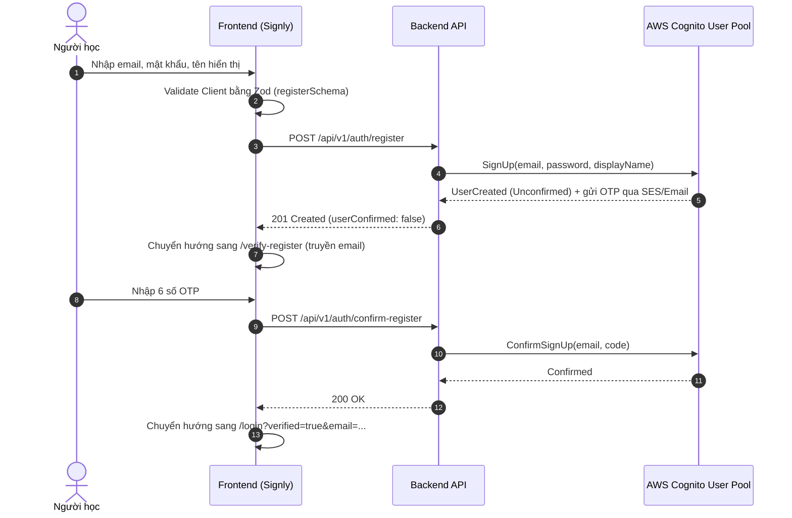
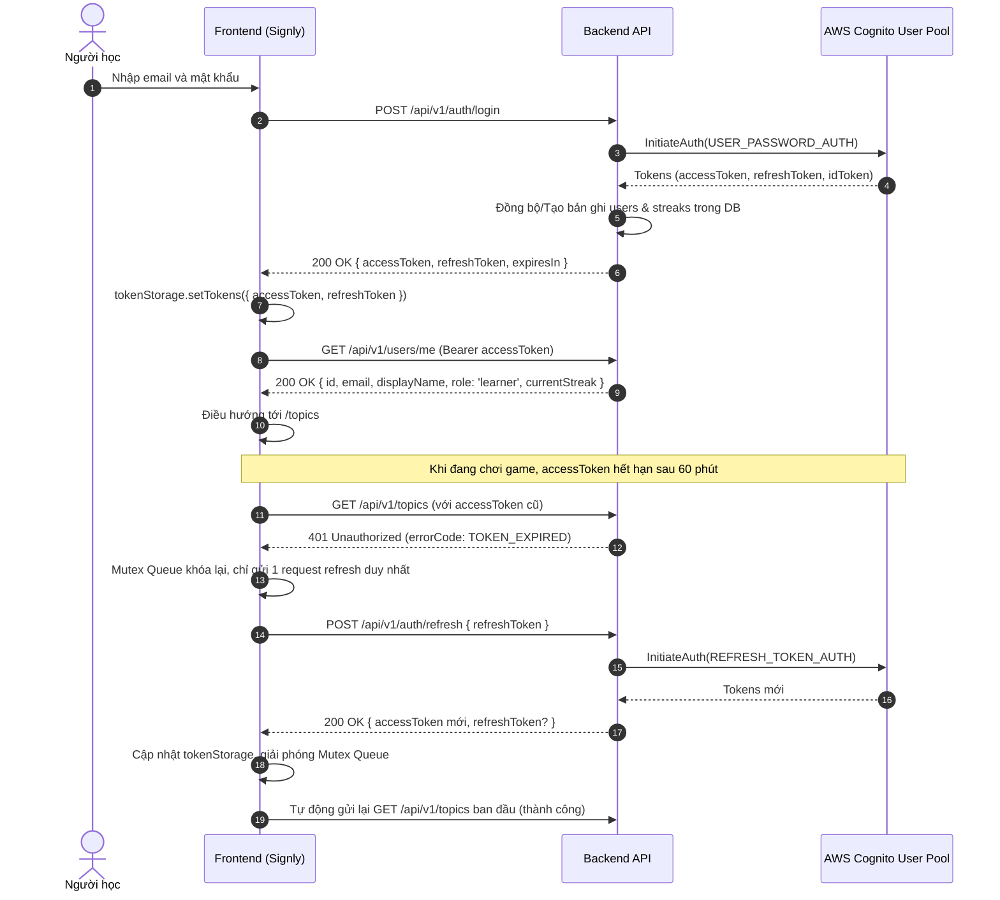
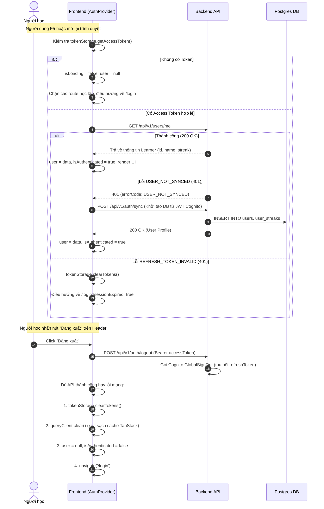
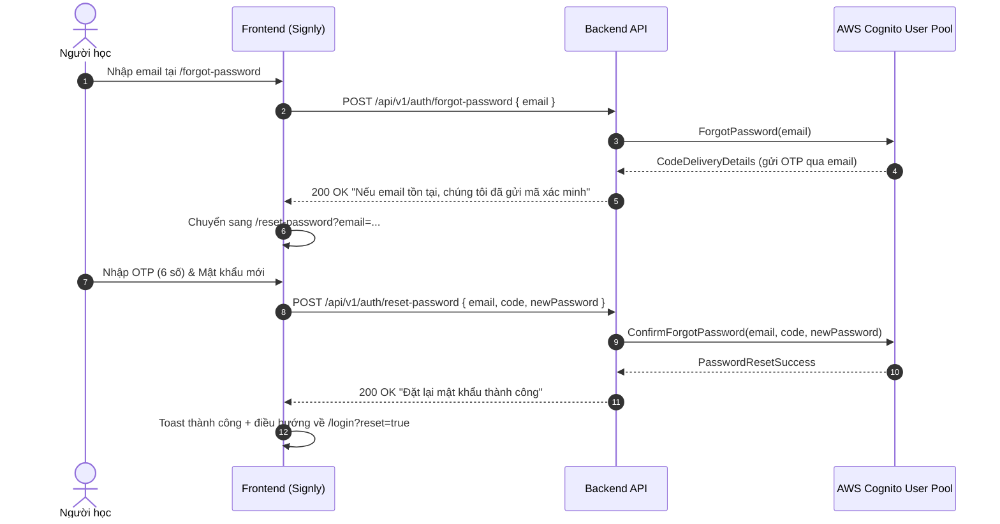

# Kế Hoạch Triển Khai Frontend Auth (AWS Cognito Architecture)

> [!IMPORTANT]
> **Phạm vi tài liệu:** Tập trung 100% vào toàn bộ vòng đời xác thực của **Người học (Learner)**. Loại bỏ hoàn toàn các phần liên quan đến Quản trị viên (Admin) theo yêu cầu.

---

## 1. Nguyên Tắc Cốt Lõi Về Kiến Trúc AWS Cognito Trên Frontend

### 1.1. Mô hình Backend Bridge (Zero AWS Credentials ở Client)
- **Không nhúng AWS SDK hay IAM Credentials vào Frontend:** Trình duyệt không chứa `AWS_ACCESS_KEY_ID`, `AWS_SECRET_ACCESS_KEY` hay Client Secret của Cognito.
- **Backend làm cổng ủy quyền (Bridge):** Frontend chỉ giao tiếp với Backend qua REST API chuẩn (`/api/v1/auth/*`). Backend sử dụng AWS SDK để gọi các hành động Cognito User Pool:
  - `SignUp` $\rightarrow$ `POST /api/v1/auth/register`
  - `ConfirmSignUp` $\rightarrow$ `POST /api/v1/auth/confirm-register`
  - `ResendConfirmationCode` $\rightarrow$ `POST /api/v1/auth/resend-code`
  - `InitiateAuth` (USER_PASSWORD_AUTH) $\rightarrow$ `POST /api/v1/auth/login`
  - `InitiateAuth` (REFRESH_TOKEN_AUTH) $\rightarrow$ `POST /api/v1/auth/refresh`
  - `GlobalSignOut` $\rightarrow$ `POST /api/v1/auth/logout`
  - `ForgotPassword` $\rightarrow$ `POST /api/v1/auth/forgot-password`
  - `ConfirmForgotPassword` $\rightarrow$ `POST /api/v1/auth/reset-password`

### 1.2. Quy tắc quản lý Token bảo mật
- **Chỉ lưu `accessToken` và `refreshToken`:** Lưu trữ cục bộ qua `tokenStorage` (`localStorage`).
- **Tuyệt đối KHÔNG lưu `idToken`:** Backend chỉ chấp nhận `accessToken` (loại `Bearer`) để xác thực chữ ký JWT và tra cứu danh tính user. Việc gửi `idToken` sẽ bị backend từ chối.
- **Thời hạn sống của Token:**
  - `accessToken`: Hết hạn sau **60 phút** (`expiresIn: 3600`).
  - `refreshToken`: Thời hạn dài (thường 30 ngày) dùng để xin cấp lại `accessToken` mới mà không bắt người chơi phải đăng nhập lại giữa chừng.

---

## 2. Sơ Đồ Tuần Tự Toàn Bộ Vòng Đời Auth Người Học

### 2.1. Đăng ký & Xác minh OTP (AUTH-01) - *Đã hoàn thành*



### 2.2. Đăng nhập & Làm mới Token tự động (AUTH-02) - *Đã hoàn thành*



### 2.3. Khôi phục phiên, Đồng bộ User & Đăng xuất (AUTH-03) - *Bước tiếp theo*



### 2.4. Quên mật khẩu & Đặt lại mật khẩu (AUTH-04) - *Bước hoàn thiện*



---

## 3. Ma Trận Ánh Xạ Lỗi AWS Cognito Sang Giao Diện

Backend chuẩn hóa các exception từ AWS Cognito thành `errorCode`. Frontend hiển thị theo từng ngữ cảnh:

| Nguồn AWS Cognito Exception | Backend `errorCode` | HTTP Status | Xử lý & Hiển thị trên Frontend |
|---|---|---|---|
| `UsernameExistsException` | `EMAIL_ALREADY_EXISTS` | 409 | Báo lỗi ô email: kèm link *"Bạn đã đăng ký nhưng chưa xác minh OTP? Xác minh tại đây"*. |
| `CodeMismatchException` | `OTP_INVALID` | 400 | Báo lỗi ô OTP: *"Mã xác minh không chính xác. Vui lòng kiểm tra lại email."* |
| `ExpiredCodeException` | `OTP_EXPIRED` | 400 | Báo lỗi ô OTP: *"Mã xác minh đã hết hạn. Vui lòng bấm Gửi lại mã."* |
| `NotAuthorizedException` / `UserNotFoundException` | `INVALID_CREDENTIALS` | 401 | Banner cảnh báo đỏ: *"Email hoặc mật khẩu không chính xác."* (Không tiết lộ email có tồn tại hay không). |
| `UserNotConfirmedException` | `ACCOUNT_NOT_VERIFIED` | 403 | Banner cam đào: *"Tài khoản chưa được kích hoạt"*, kèm link dẫn thẳng tới `/verify-register?email=...`. |
| `PasswordResetRequiredException` | `PASSWORD_RESET_REQUIRED` | 403 | Banner vàng: *"Mật khẩu cần được đặt lại"*, kèm link sang `/reset-password?email=...`. |
| `InvalidPasswordException` | `WEAK_PASSWORD` | 400 | Báo lỗi dưới ô password: *"Mật khẩu cần 8-64 ký tự, có chữ hoa, thường, số và ký tự đặc biệt."* |
| `LimitExceededException` / `TooManyRequestsException` | `TOO_MANY_REQUESTS` | 429 | Banner cảnh báo thời gian chờ: *"Thao tác quá nhiều lần liên tiếp. Vui lòng thử lại sau ít phút."* |
| Bản ghi DB chưa đồng bộ | `USER_NOT_SYNCED` | 401 | Frontend tự động gọi ngầm `POST /api/v1/auth/sync` mà không làm gián đoạn người dùng. |
| Refresh token hết hạn/thu hồi | `REFRESH_TOKEN_INVALID` | 401 | Tự động xóa token, đưa về `/login?sessionExpired=true`. |

---

## 4. Cấu Trúc File & Thiết Kế Module Frontend Auth (Không Admin)

```
src/
├── features/auth/
│   ├── api/
│   │   └── authApi.ts                   # Toàn bộ 8 API endpoint xác thực người học
│   ├── context/
│   │   ├── AuthContext.ts               # Định nghĩa interface AuthContextType
│   │   └── AuthProvider.tsx             # Khôi phục phiên, lắng nghe token, đồng bộ DB
│   ├── hooks/
│   │   └── useAuth.ts                   # Hook tiện ích { user, isAuthenticated, login, logout }
│   ├── components/
│   │   ├── LoginForm.tsx                # Form đăng nhập (AUTH-02) [Đã xong]
│   │   ├── RegisterForm.tsx             # Form đăng ký (AUTH-01) [Đã xong]
│   │   ├── VerifyRegisterForm.tsx       # Form xác minh OTP (AUTH-01) [Đã xong]
│   │   ├── ForgotPasswordForm.tsx       # Form gửi email xin OTP reset pass (AUTH-04)
│   │   ├── ResetPasswordForm.tsx        # Form nhập OTP & mật khẩu mới (AUTH-04)
│   │   └── ProtectedRoute.tsx           # Bảo vệ các route học tập (chuyển hướng kèm redirect param)
│   ├── pages/
│   │   ├── LoginPage.tsx                # Trang đăng nhập [Đã xong]
│   │   ├── RegisterPage.tsx             # Trang đăng ký [Đã xong]
│   │   ├── VerifyRegisterPage.tsx       # Trang xác minh OTP [Đã xong]
│   │   ├── ForgotPasswordPage.tsx       # Trang quên mật khẩu (AUTH-04)
│   │   └── ResetPasswordPage.tsx        # Trang đặt lại mật khẩu (AUTH-04)
│   ├── schemas/
│   │   ├── loginSchema.ts               # [Đã xong]
│   │   ├── registerSchema.ts            # [Đã xong]
│   │   ├── verifyRegisterSchema.ts      # [Đã xong]
│   │   ├── forgotPasswordSchema.ts      # Zod schema cho forgot password
│   │   └── resetPasswordSchema.ts       # Zod schema cho reset password
│   └── types/
│       └── auth.types.ts                # TypeScript interfaces cho request, response & state
└── lib/
    ├── apiClient.ts                     # Axios client + Mutex Token Refresh Interceptor [Đã xong]
    └── tokenStorage.ts                  # LocalStorage quản lý an toàn accessToken & refreshToken [Đã xong]
```

---

## 5. Kế Hoạch Triển Khai Chi Tiết Từng Bước Tiếp Theo

### Bước 1: Triển khai [AUTH-03] - Quản lý phiên, đồng bộ & bảo vệ route người học
1. **`authApi.ts`**:
   - Thêm `logout: () => http.post<null>('/auth/logout')`.
   - Kiểm tra lại `getMe` và `syncUser`.
2. **`AuthProvider.tsx` & `useAuth.ts`**:
   - Khởi tạo `isLoading = true` khi khởi động ứng dụng.
   - Nếu có token trong `tokenStorage`, gọi `authApi.getMe()`.
   - Nếu nhận mã lỗi `USER_NOT_SYNCED`, tự động gọi `authApi.syncUser()` rồi lấy lại profile.
   - Bắt sự kiện toàn cục `window.addEventListener('auth:unauthorized', ...)` để đăng xuất tự động khi refresh token thất bại.
   - Hàm `logout()`: Xóa token, xóa cache React Query, chuyển hướng về `/login`.
3. **`ProtectedRoute.tsx`**:
   - Kiểm tra `isAuthenticated`. Nếu chưa, chuyển hướng về `/login?redirect=${encodeURIComponent(location.pathname + location.search)}`.
   - Sau khi đăng nhập thành công ở `LoginForm`, kiểm tra `searchParams.get('redirect')` để đưa người dùng quay lại đúng màn hình đang dở.
4. **Cập nhật `Header.tsx` & `router.tsx`**:
   - Hiển thị tên `user.displayName`, streak thật `user.currentStreak` (thay vì mock).
   - Nút đăng xuất gọi trực tiếp `logout()` từ `useAuth()`.
   - Bọc các route người học (`/topics`, `/game/:sessionId`, `/progress`, `/leaderboard`) trong `ProtectedRoute`.

### Bước 2: Triển khai [AUTH-04] - Quên và đặt lại mật khẩu
1. **Schemas Zod**:
   - `forgotPasswordSchema.ts`: Validate email hợp lệ.
   - `resetPasswordSchema.ts`: Validate OTP 6 chữ số và mật khẩu mới tuân thủ quy tắc AWS Cognito (chữ hoa, thường, số, ký tự đặc biệt).
2. **API Endpoint trong `authApi.ts`**:
   - `forgotPassword: (data: ForgotPasswordRequest) => http.post<null>('/auth/forgot-password', data)`
   - `resetPassword: (data: ResetPasswordRequest) => http.post<null>('/auth/reset-password', data)`
3. **Components & Pages**:
   - Xây dựng `ForgotPasswordForm.tsx` & `ResetPasswordForm.tsx` theo chuẩn giao diện 3D Signly.
   - Chuyển hướng mượt mà: `/forgot-password` $\rightarrow$ `/reset-password?email=...` $\rightarrow$ `/login?reset=true`.

---

## 6. Tiêu Chí Nghiệm Thu (Acceptance Criteria)
- [x] **[AUTH-01] Đăng ký & Kích hoạt:** Hoàn thành, 0 lỗi linter, đã push git.
- [x] **[AUTH-02] Đăng nhập & Làm mới token:** Hoàn thành, interceptor mutex refresh hoạt động, đã push git.
- [ ] **[AUTH-03] Khôi phục phiên & Route Guard:**
  - F5 trang web không bị mất trạng thái đăng nhập.
  - Tự động gọi `syncUser` nếu Cognito chưa đồng bộ DB.
  - Vào thẳng `/game/1` khi chưa đăng nhập sẽ bị đẩy về `/login`, đăng nhập xong quay lại đúng `/game/1`.
  - Đăng xuất gọi `GlobalSignOut`, dọn sạch cache token và TanStack Query.
- [ ] **[AUTH-04] Quên & Đặt lại mật khẩu:**
  - Gửi mã OTP khôi phục qua email thành công.
  - Xác nhận đổi mật khẩu mới thành công, thông báo toast và đăng nhập được với mật khẩu mới.
