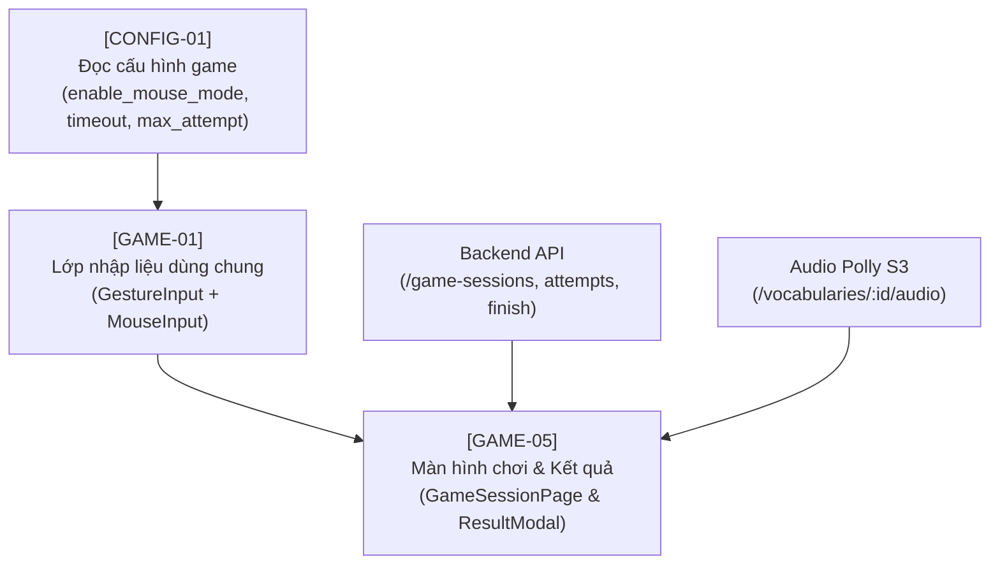
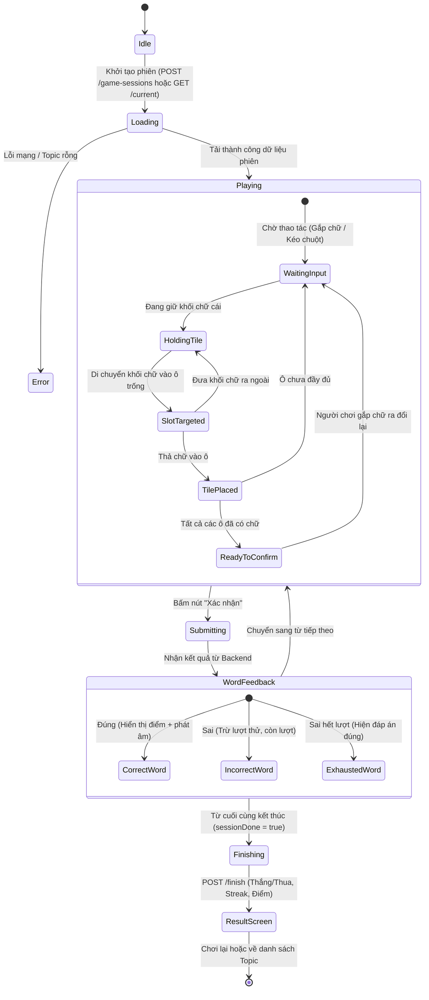

# Kế Hoạch Triển Khai Game Chữ Cái Bằng Cử Chỉ Bàn Tay (Signly)

> [!IMPORTANT]
> **Tài liệu kiến trúc & triển khai:** Áp dụng toàn bộ giải thuật toán học, bộ lọc khử nhiễu, Web Worker MediaPipe, đồ họa găng tay ảo từ thư mục [aws-workshop-main](file:///d:/aws-workshop-main/aws-workshop-main) vào hệ thống React 19 + TypeScript của dự án `english-learn-game`, chuẩn hóa theo ngôn ngữ thiết kế Signly (Theme Colors, 3D buttons, pastel card).

---

## 1. Bản Đồ Các Issue Game & Phụ Thuộc



---

## 2. Kiến Trúc Lớp Nhập Liệu [GAME-01] (Dựa trên `aws-workshop-main`)

### 2.1. Phân tách kiến trúc 3 tầng (3-Layer Architecture)

```
┌────────────────────────────────────────────────────────────────────────┐
│                        TẦNG 1: UI GIAO DIỆN GAME                       │
│  GameSessionPage / LetterTile / AnswerSlots / CameraPreview / Overlay  │
│  (Chỉ nhận các sự kiện: onSelectTile, onMoveTile, onDropTile, onCancel)│
└───────────────────────────────────┬────────────────────────────────────┘
                                    │
┌───────────────────────────────────▼────────────────────────────────────┐
│                  TẦNG 2: INPUT CONTROLLER & HOOK                       │
│      useInputController() ──► Điều phối tự động (Camera <-> Chuột)     │
│       ├── GestureInputController (Webcam + MediaPipe + Glove Canvas)   │
│       └── MouseInputController (Pointer Events: Chuột + Cảm ứng)       │
└───────────────────────────────────┬────────────────────────────────────┘
                                    │
┌───────────────────────────────────▼────────────────────────────────────┐
│                    TẦNG 3: MATH & WEB WORKER ENGINE                    │
│   ├── public/workers/hand-worker.js (@mediapipe/tasks-vision WASM)     │
│   ├── gestureRecognition.ts (palmWidth, pinchRatio, advanceGrip)       │
│   └── gestureSmoothing.ts (filterHandLandmarks, smoothVisualLandmarks) │
└────────────────────────────────────────────────────────────────────────┘
```

### 2.2. Chi tiết các giải thuật cốt lõi từ `aws-workshop-main`

1. **Web Worker không chặn Main Thread (`hand-worker.js`)**:
   - Khởi tạo `@mediapipe/tasks-vision@1.0.1` với file mô hình `hand_landmarker.task` trên luồng phụ.
   - Truyền khung hình video dưới dạng `ImageBitmap` bằng zero-copy Transferable Object (`[bitmap]`).
   - Xử lý nhận diện 2 bàn tay song song (`numHands: 2`), trả về 21 landmarks chuẩn hóa [0, 1] và nhãn `handedness` (Left/Right).

2. **Bất biến theo khoảng cách (`palmWidth` scale-invariant)**:
   - Đo chiều rộng lòng bàn tay: $\text{palmWidth} = \text{distance}(\text{landmark}[5], \text{landmark}[17])$.
   - Tỷ lệ chụm ngón tay: $\text{pinchRatio} = \frac{\text{distance}(\text{thumb}, \text{finger})}{\text{palmWidth}}$.
   - Hysteresis 2 khung hình:
     - Bắt đầu gắp: $\text{pinchRatio} < 0.58$ liên tục 2 frame.
     - Thả chữ: $\text{pinchRatio} > 0.95$ liên tục 2 frame.
   - Cặp ngón hợp lệ: `[4, 8]` (ngón cái - ngón trỏ) và `[4, 12]` (ngón cái - ngón giữa). Loại trừ hoàn toàn nắm đấm (`isFistClosed`) và ngón tay vô tình chạm nhau.

3. **Bộ lọc khử nhiễu & Làm mượt (Filtering & Smoothing)**:
   - `filterHandLandmarks`: Khử giật đột biến (spike rejection) bằng `medianPoint` 3 khung hình lịch sử; phát hiện di dời tay lớn (`relocation`); bộ lọc vận tốc thông thấp (Low-pass velocity filter).
   - `smoothVisualLandmarks`: Hệ số suy giảm thích ứng $\tau$ (tăng damping khi tay giữ chữ hoặc đứng yên để chữ không rung; giảm damping khi di chuyển nhanh để phản hồi tức thì).

4. **Đồ họa găng tay phi hành gia (Virtual Glove Overlay)**:
   - Canvas full-screen vẽ găng tay gồm cổ tay (cuff), đốt ngón tay, đường chỉ may, đệm ngón và điểm sáng con trỏ phát quang ở vị trí gắp.
   - Ánh xạ trực tiếp sang bảng màu Signly:
     - Găng tay 1: Vải `#eef2fa`, đường may `#322c82`, điểm nhấn Cam `#ff7b62`, phát sáng `#ffdcd4`.
     - Găng tay 2: Vải `#d8f1e7`, đường may `#19634b`, điểm nhấn `#10b981`, phát sáng `#a3e4cb`.

---

## 3. Máy Trạng Thái Màn Chơi [GAME-05] (Game State Machine)



---

## 4. Đặc Tả Endpoint & Dữ Liệu Backend Game

| Endpoint | Method | Input Payload | Output Data Mẫu | Nghiệp vụ |
|---|---|---|---|---|
| `/api/v1/game-configs/public` | `GET` | Không | `{ maxAttemptPerWord: 3, sessionTimeoutMinutes: 30, enableMouseMode: true, enableAudio: true }` | Đọc cấu hình game, kiểm tra quyền dùng chuột |
| `/api/v1/game-sessions` | `POST` | `{ topicId: 1 }` | `{ sessionId: 5001, words: [{ vocabId, wordLength, letters: ['P','L','A','E','P'], meaningVi, ipa }] }` | Tạo phiên mới, xáo trộn chữ cái ở backend |
| `/api/v1/game-sessions/current` | `GET` | Không | Dữ liệu phiên `playing` đang dở (hoặc `null` nếu không có) | F5 không mất phiên chơi đang dở |
| `/api/v1/game-sessions/{id}/attempts` | `POST` | `{ vocabId: 1, submittedLetters: "APPLE" }` | `{ isCorrect: true, points: 10, wordDone: true, sessionDone: false, sessionScore: 10 }` | Chấm điểm nộp từ, backend giữ đáp án |
| `/api/v1/game-sessions/{id}/finish` | `POST` | Không | `{ isWon: true, score: 50, currentStreak: 4, weeklyScore: 120 }` | Chốt điểm, tăng streak nếu thắng |
| `/api/v1/game-sessions/{id}/cancel` | `POST` | Không | `null` | Thoát ngang phiên chơi |

---

## 5. Cấu Trúc Thư Mục Triển Khai Trong Mã Nguồn

```
src/features/game/
├── api/
│   ├── gameConfigApi.ts              # API GET /game-configs/public
│   └── gameSessionApi.ts             # API /game-sessions, attempts, finish, cancel
├── types/
│   ├── gameConfig.types.ts           # Types cấu hình game
│   └── gameSession.types.ts          # Types phiên chơi, từ vựng, lượt nộp
├── input/
│   ├── controllers/
│   │   ├── InputController.ts        # Interface chuẩn: onMove, onGrab, onRelease, start, stop
│   │   ├── GestureInputController.ts # Điều khiển camera, Worker, Canvas găng tay ảo
│   │   └── MouseInputController.ts   # Điều khiển kéo thả chuột & cảm ứng
│   ├── hooks/
│   │   ├── useGameConfig.ts          # Hook lấy cấu hình hệ thống
│   │   └── useInputController.ts     # Hook điều phối chuyển đổi Camera <-> Chuột
│   ├── utils/
│   │   ├── gestureRecognition.ts     # Port từ hand-gestures.mjs (palmWidth, pinchRatio, advanceGrip)
│   │   └── gestureSmoothing.ts       # Port từ hand-gestures.mjs (filterHandLandmarks, smoothVisualLandmarks)
│   ├── components/
│   │   ├── CameraPermissionGate.tsx  # Modal xin quyền camera thân thiện ("Video chỉ xử lý trên máy bạn")
│   │   ├── CameraPreview.tsx         # Khung video camera nhỏ góc màn hình, có nút ẩn/hiện
│   │   └── HandCursorOverlay.tsx     # Canvas toàn màn hình vẽ găng tay ảo theo màu Signly
│   └── __tests__/
│       └── gestureRecognition.test.ts # Unit test toán học cử chỉ (dựa trên hand-gestures.test.mjs)
├── components/
│   ├── LetterTile.tsx                # Khối chữ cái 3D tương tác (drag-source, hand-hover)
│   ├── AnswerSlots.tsx               # Hàng ô trống đựng chữ (slot targeted, hand-target)
│   ├── WordClueCard.tsx              # Thẻ câu hỏi (Nghĩa tiếng Việt, IPA, nút nghe audio Polly)
│   ├── GameControlBar.tsx            # Nút "Xác nhận" (3D button) & Nút "Xóa làm lại"
│   ├── GameSessionHeader.tsx         # Thanh tiến độ từ vựng, điểm số, đồng hồ timeout
│   └── GameResultModal.tsx           # Hộp thoại kết quả thắng/thua, cập nhật streak, điểm tuần
└── pages/
    └── GameSessionPage.tsx           # Trang màn chơi chính tích hợp hoàn chỉnh
```

---

## 6. Kế Hoạch Các Bước Thực Hiện Cụ Thể

### Giai đoạn 1: [CONFIG-01] & Nền tảng API Game
1. Tạo `src/features/game/types/gameConfig.types.ts` & `src/features/game/api/gameConfigApi.ts`.
2. Tạo hook `useGameConfig.ts` sử dụng TanStack Query (cache cấu hình trong phiên).
3. Tạo `src/features/game/types/gameSession.types.ts` & `src/features/game/api/gameSessionApi.ts`.

### Giai đoạn 2: [GAME-01] Đóng gói Lớp Nhập Liệu Cử Chỉ & Chuột
1. Port các hàm giải thuật từ `aws-workshop-main/dist/hand-gestures.mjs` sang `gestureRecognition.ts` và `gestureSmoothing.ts` (100% strict TypeScript, không dùng `any`).
2. Đặt `hand-worker.js` vào thư mục `public/workers/hand-worker.js` để Vite phục vụ tĩnh mượt mà.
3. Viết unit test `gestureRecognition.test.ts` dựa trên `hand-gestures.test.mjs`.
4. Tạo `InputController.ts`, `GestureInputController.ts` và `MouseInputController.ts`.
5. Tạo `CameraPermissionGate.tsx`, `CameraPreview.tsx` và `HandCursorOverlay.tsx` (áp dụng bảng màu Signly).
6. Viết hook `useInputController.ts` hỗ trợ tự động fallback chuột khi camera bị từ chối hoặc lỗi FPS.

### Giai đoạn 3: [GAME-05] Màn Hình Chơi Ghép Chữ & Kết Quả
1. Tạo các component bàn cờ chữ cái: `LetterTile.tsx`, `AnswerSlots.tsx`, `WordClueCard.tsx`, `GameControlBar.tsx`.
2. Kết nối `InputController` vào bàn cờ:
   - Khi gắp khối chữ: khối chữ gắn theo con trỏ tay/chuột (`ghost`).
   - Khi đưa vào ô: ô đổi màu viền highlight (`hand-target`).
   - Khi thả: chữ rơi vào ô; cho phép nhặt lại chữ trong ô đưa về kho chữ.
3. Xử lý nút **Xác nhận**: chỉ sáng khi điền đủ ô, gửi `POST /attempts`, hiển thị phản hồi đúng/sai, số lượt thử còn lại.
4. Xử lý khi hoàn tất tất cả từ: tự động gọi `POST /finish`, hiển thị `GameResultModal.tsx` chúc mừng, cập nhật chuỗi streak và cộng điểm tuần.
